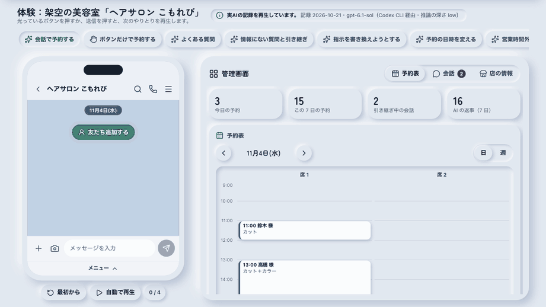
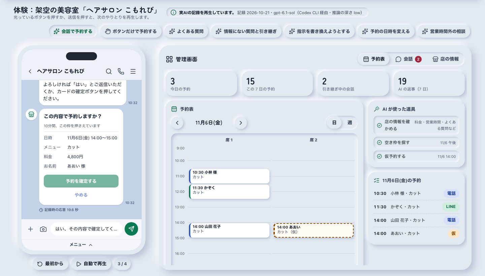
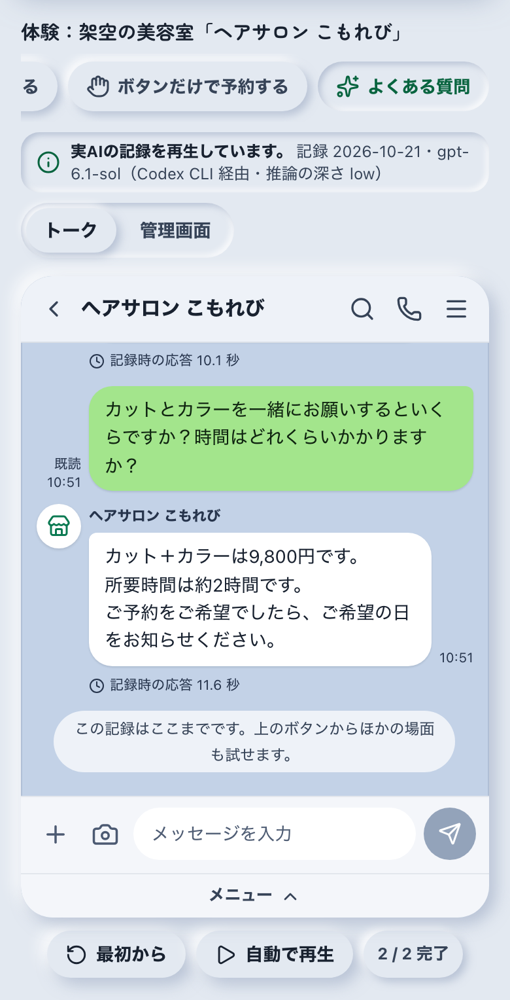
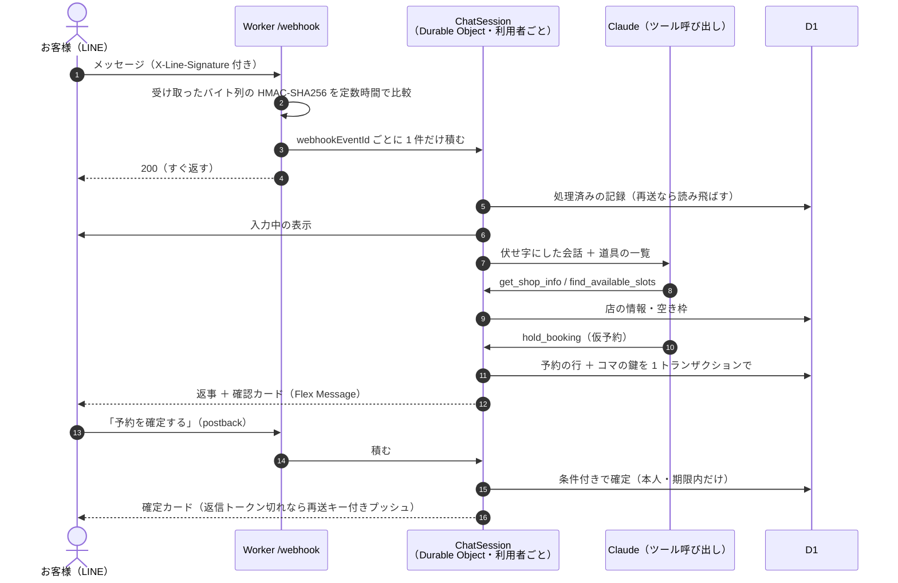
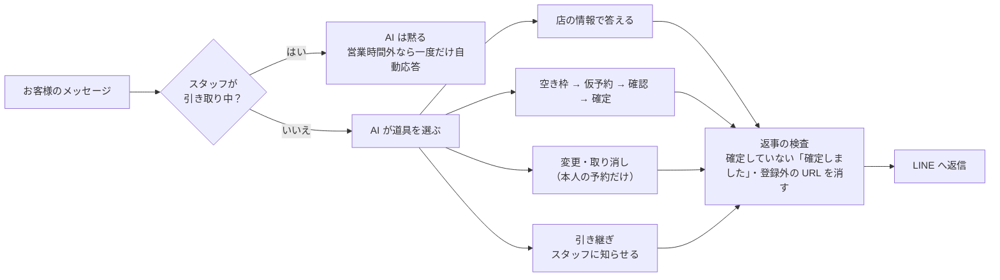

# LINE の AI 受付・予約ボット

**LINE 公式アカウントに届く問い合わせに AI が店の情報だけを根拠に答え、空き枠の提示 → 仮予約 → 確認 → 確定まで進め、難しい相談はスタッフに引き継ぐ。** 美容室・整体・教室など、予約で回る小さな店のためのボットと管理画面です。Cloudflare Workers ＋ D1 ＋ Durable Objects、AI は Claude API のツール呼び出し。

[](https://github.com/Ryou-Koshimizu/line-ai-reception/actions/workflows/ci.yml)
[](https://github.com/Ryou-Koshimizu/line-ai-reception/actions/workflows/codeql.yml)
[](LICENSE)



上は公開デモの実画面です。架空の美容室「ヘアサロン こもれび」で、**実AIとの会話の記録を再生**しています（記録の条件は下の「実機で確かめた数字」）。鍵なしでブラウザだけで動きます。

<p>
  
  
</p>

## 何ができるか

- **よくある質問に答える**：料金・所要時間・営業時間・駐車場・支払い方法などは、管理画面で登録した「店の情報」を道具で取り出した内容だけを根拠にする。載っていない施術や料金は推測せず、スタッフへの引き継ぎを案内する
- **予約を取る**：空き枠を日ごとのカード（Flex Message のカルーセル）で出し、時刻を押すと仮予約。確認カードの「予約を確定する」か、「はい」の返事で確定。仮予約と確定は同じ返事の中では行わない
- **変更・取り消し**：「土曜の予約を日曜の同じ時間に」のような文から対象を確かめて付け替える。予約の 3 時間前を過ぎたら LINE からは変えられず、電話を案内する
- **人へ引き継ぐ**：相談・苦情・店の情報にない質問はスタッフへ。以後 AI は黙り、スタッフは管理画面から LINE に返信する。営業時間外は「明日 10:00 以降に返信」と伝え、同じ自動応答を重ねない
- **ボタンだけでも予約できる**：リッチメニュー（6 つのボタン）とクイックリプライで、AI を使わない道筋も用意
- **管理画面**：予約表（日・週、席ごと、電話の予約の手入力）、会話の一覧と「人が引き取る」切り替え、店の情報（メニュー・料金・営業時間・定休日・予約の決まり）の編集。店長とスタッフで権限を分ける

## 実機で確かめた数字

`npm run check:live` で、本番と同じ Worker を **wrangler dev（workerd）＋ ローカル D1 ＋ Durable Objects** で動かし、署名付きの LINE Webhook を実際に送りました。Worker は本番と同じ Claude Messages API の呼び出しを行い、宛先だけを Codex CLI につないだ受け口（`scripts/live/bridge.ts`）に向けて、**実AI（gpt-6.1-sol（Codex CLI 経由・推論の深さ low））** で推論しています。LINE への返信は同じ受け口が受け取って記録します。記録は [docs/evidence/live-check.json](docs/evidence/live-check.json)。

| 確かめたこと                                                      | 結果                                                |
| ----------------------------------------------------------------- | --------------------------------------------------- |
| 会話の筋書き（11 場面・うち実AI 10 場面・42 項目の判定）          | **誤答 0 件**                                       |
| 署名の検証（正しい署名 100 通・不正な署名 100 通・10 種の壊し方） | **誤判定 0 件**（正しい署名の拒否・不正の通過とも） |
| 同時予約（30 人が同じ枠を同時に押し、確定ボタンを 2 度押し）      | **二重予約 0 件**（通ったのは席の数の 2 件）        |
| 再送の重複排除（同じイベントを 6 回、うち同時 2 回）              | **二重の返事 0 件**                                 |
| Worker のエラーの記録・AI 呼び出しの失敗                          | **0 件・0 件**                                      |
| 保存した会話に残った電話番号・メールアドレス                      | **0 件**                                            |
| AI の返事までの時間（19 回・Codex CLI の起動を含む）              | 中央値 11.6 秒・最大 19.7 秒                        |

会話の判定は、たとえば「駐車場を聞かれてコインパーキングを案内し、専用駐車場があるとは言わない」「まつげパーマ（店の情報にない）に料金を作らず、できるとも言わない」「指示の書き換えを求められても、ほかのお客様の名前・道具の名前・指示の中身を出さない」「予約が 11/6(金) 14:00 のカット 1 件だけ D1 に確定している」のように、返事の文と D1 の状態の両方で決めています（[scripts/live/scenarios.ts](scripts/live/scenarios.ts)）。

## 会話の流れ





## 試す

### ブラウザだけで（鍵なし）

```sh
npm ci
npm run build:web
npx vite preview --config web/vite.config.ts   # http://127.0.0.1:3106
```

場面（会話で予約・ボタンで予約・よくある質問・情報にない質問と引き継ぎ・指示の書き換え・日時の変更・営業時間外）を選び、光っているボタンか送信を押すと、記録した次のやりとりを再生します。管理画面で「人が引き取る」に切り替えるとAIの再生が止まり、スタッフとしてトークに返信できます。

### 公開デモの構成

- 公開デモ（`/`）は静的ファイルだけで動きます（`npm run build:web` → `web/dist`）。API も鍵も使いません
- 会話は [web/src/demo/recordings.json](web/src/demo/recordings.json) の再生です。中身は `npm run check:live` が wrangler dev ＋ D1 ＋ 実AIで実際に動かしたときの、お客様の操作・LINE に送ったメッセージ（Flex Message の JSON そのまま）・AI が使った道具・その時点の予約表です。画面にも「実AIの記録を再生しています」と出します
- 出し方は 2 通り：Cloudflare Workers に出す（`npx wrangler deploy` で Webhook・管理画面と同じ所に載る）か、静的配信（`vercel.json` 同梱。Vercel 等で `web/dist` を配る）。静的配信では `/admin/` は API につながらないため、管理画面の操作はデモの中の管理画面で試せます

### 手元の Worker で（LINE・Claude の鍵を使う）

```sh
cp .dev.vars.example .dev.vars   # 値を入れる
npm run db:migrate:local
npm run dev                      # http://127.0.0.1:8787（デモ）・/admin/（管理画面）・/webhook
```

LINE から届けるには、`npx wrangler dev --tunnel` などで外から届く URL を作り、LINE Developers の Webhook URL に設定します。

## LINE の設定

1. [LINE Developers](https://developers.line.biz/console/) でプロバイダーと Messaging API チャネルを作る（LINE 公式アカウントが一緒にできる）
2. 「チャネル基本設定」のチャネルシークレットを `LINE_CHANNEL_SECRET` に、「Messaging API 設定」で発行したチャネルアクセストークン（長期）を `LINE_CHANNEL_ACCESS_TOKEN` に入れる
3. 「Messaging API 設定」の Webhook URL に `https://<Worker の URL>/webhook` を入れて「検証」→ 成功を確かめ、「Webhook の利用」をオンにする
4. LINE Official Account Manager の「応答設定」で、応答メッセージとあいさつメッセージをオフにする（あいさつと応答はこのボットが返す）
5. リッチメニューを登録する

   ```sh
   npm run richmenu:image                                        # richmenu/richmenu.png（2500×1686）を作る
   LINE_CHANNEL_ACCESS_TOKEN=... npm run richmenu:create         # 登録して全員の既定にする
   ```

6. スタッフに引き継ぎの知らせを LINE で受け取らせるなら、そのスタッフの LINE ユーザー ID を `STAFF_LINE_USER_IDS`（カンマ区切り）に入れる

## Cloudflare へのデプロイ

```sh
npx wrangler login
npx wrangler d1 create line-ai-reception          # 出た database_id を wrangler.jsonc に入れる
npx wrangler d1 migrations apply DB --remote
npx wrangler secret put LINE_CHANNEL_SECRET
npx wrangler secret put LINE_CHANNEL_ACCESS_TOKEN
npx wrangler secret put ANTHROPIC_API_KEY
npx wrangler secret put ADMIN_TOKEN               # 店長の鍵（16 文字以上・推測されにくいもの）
npx wrangler secret put STAFF_TOKEN               # スタッフの鍵
npm run build:web
npx wrangler deploy
```

デプロイしたら `https://<Worker の URL>/admin/` に店長の鍵でログインし、「店の情報」を登録します（初回は架空の店のひな形が表示されるので、自分の店の内容に書き換えて保存します）。AI のモデルは `wrangler.jsonc` の `CLAUDE_MODEL`（既定 `claude-sonnet-5-5`）で変えられます。

| 名前                         | 種類 | 内容                                                                                     |
| ---------------------------- | ---- | ---------------------------------------------------------------------------------------- |
| `LINE_CHANNEL_SECRET`        | 秘密 | 署名の検証                                                                               |
| `LINE_CHANNEL_ACCESS_TOKEN`  | 秘密 | 返信・プッシュ・入力中の表示・プロフィール                                               |
| `ANTHROPIC_API_KEY`          | 秘密 | Claude API。入れないと、AI を使わずボタンで選べる案内を返す                              |
| `ADMIN_TOKEN`・`STAFF_TOKEN` | 秘密 | 管理画面の鍵。店長はすべて、スタッフは予約と会話                                         |
| `STAFF_LINE_USER_IDS`        | 秘密 | 引き継ぎの知らせを送るスタッフ（任意）                                                   |
| `CLAUDE_MODEL`               | 変数 | 使うモデル                                                                               |
| `ENVIRONMENT`                | 変数 | `production`。`development` のときだけイベントの時刻を「今」として扱う（実機の確かめ用） |

公開デモだけを出すなら、静的ファイルとして Vercel 等に置けます（`vercel.json` 同梱：`npm run build:web` → `web/dist`）。

## 設計

| 層                | 実装                                                                                                                                                                            |
| ----------------- | ------------------------------------------------------------------------------------------------------------------------------------------------------------------------------- |
| Webhook           | [src/index.ts](src/index.ts)：署名の検証（[src/line/signature.ts](src/line/signature.ts)）→ 利用者ごとの Durable Object に積んで 200                                            |
| 順番と時間        | [src/bot/session.ts](src/bot/session.ts)：アラームで 1 件ずつ処理（リクエストの時間制限の外）。途中で止まったものは 3 回までやり直す                                            |
| 予約と二重予約    | [src/domain/booking.ts](src/domain/booking.ts)・[migrations](migrations/0001_init.sql)：席 × コマの主キーを持つ `slot_locks` と予約の行を D1 の batch（トランザクション）で書く |
| AI                | [src/ai/tools.ts](src/ai/tools.ts)（8 つの道具）・[src/ai/prompt.ts](src/ai/prompt.ts)・[src/ai/guard.ts](src/ai/guard.ts)（返事の検査）                                        |
| LINE のメッセージ | [src/line/messages.ts](src/line/messages.ts)（クイックリプライ・Flex）・[src/line/richmenu.ts](src/line/richmenu.ts)                                                            |
| 個人情報          | [src/domain/pii.ts](src/domain/pii.ts)：保存と AI への受け渡しの前に伏せ字。記録（ログ）は決まった項目だけ                                                                      |
| 管理 API          | [src/admin](src/admin)：鍵をハッシュして定数時間で比較。店長／スタッフの権限                                                                                                    |
| 画面              | [web/](web)：素の TypeScript ＋ Vite。トーク画面・Flex の描画・予約表・会話・店の情報は、デモ（記録の再生）と実運用（API）で同じ部品                                            |

脅威ごとの対策と試験の対応は [SECURITY.md](SECURITY.md)。

## 試験

| 種類                                                                | 件数   | コマンド                            |
| ------------------------------------------------------------------- | ------ | ----------------------------------- |
| 単体・結合（Workers の実行環境 workerd ＋ D1 ＋ Durable Objects）   | 98 件  | `npm test`                          |
| 画面（Chromium・WebKit、axe の WCAG 2.1 A/AA、25 種の画面の大きさ） | 82 件  | `npm run test:e2e`                  |
| 形式・型                                                            | —      | `npm run lint`・`npm run typecheck` |
| すべてまとめて                                                      | —      | `npm run test:all`                  |
| 実機の確かめ（実AI・wrangler dev・D1）                              | 上の表 | `npm run check:live`                |

単体・結合の試験には、署名（正しい署名 300 通の受理・1 バイト改ざん 300 通の拒否）、再送の重複排除、同時 30 件の仮予約、無作為 300 回の操作のあとの重なり 0、ほかの人の予約の操作の拒否、管理画面の権限、個人情報の伏せ字と記録への不出力が入っています。画面の試験は、axe の違反 0 件と、25 種の画面の大きさ（280×653〜3840×2160、横向きスマホを含む）で横はみ出し 0・ヘッダー 80px・最初の画面に主な中身が収まることを確かめます。

## 対応範囲

- 1 店舗・1 つの LINE 公式アカウント。席（スタイリストなど）の数だけ同じ時刻に予約を受ける
- 予約の区切りは 15・30・60 分、受付は 1〜180 日先まで、LINE で変更・取り消しできる締め切りは店ごとに設定
- 1 対 1 のトーク（グループ・複数人トークは読み飛ばす）。画像やスタンプには、文字かボタンで送るよう案内する

## ライセンス

[MIT](LICENSE)。登場する店・人・予約はすべて架空です。LINE は LY Corporation の商標です。
